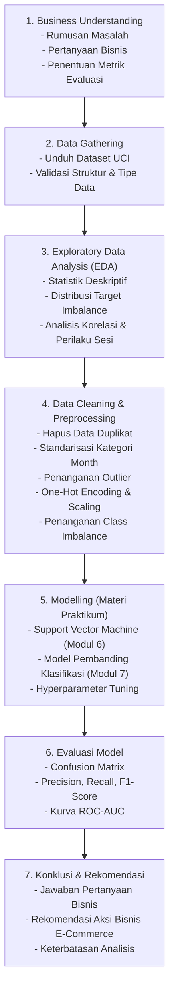

# Prediksi Niat Pembelian Pengunjung Toko Online Berdasarkan Perilaku Sesi
### Proyek Akhir Praktikum Data Science (Semester Ganjil 2026/2027)
**Program Studi Informatika - Fakultas Teknik Industri**  
**Universitas Pembangunan Nasional "Veteran" Yogyakarta**

---

## Informasi Kelompok

- **Nomor Kelompok**: 61
- **Nama Kelompok**: Mau ARGON atau ASTRA?
- **Kelas**: IF-H

### Anggota Kelompok

| No | NIM | Nama Mahasiswa | Kelas |
|:--:|:---:|:---------------|:-----:|
| 1 | 123240135 | Oktavian Prasetya Adi | IF-H |
| 2 | 123240019 | Marvel Valensiano | IF-H |
| 3 | 123240069 | Adhafa Joan Putranto | IF-H |
| 4 | 123240160 | Dzaki Ghatfaan Abhipraya | IF-H |

---

## Ringkasan Proyek

Dalam industri e-commerce, tingkat konversi dari pengunjung situs menjadi pembeli riil umumnya berkisar antara 2% hingga 5%. Sebagian besar pengunjung menjelajahi katalog produk namun meninggalkan situs web tanpa menyelesaikan transaksi (*cart abandonment*).

Proyek ini bertujuan untuk membangun model machine learning klasifikasi biner berbasis data perilaku sesi (*session behavior*) guna memprediksi apakah suatu sesi kunjungan pengguna di situs web toko online akan menghasilkan transaksi pembelian (`Revenue = True`) atau tidak (`Revenue = False`). Melalui identifikasi dini niat beli pengunjung secara real-time, sistem dapat membantu pihak pengelola toko online menentukan intervensi yang tepat (seperti penawaran voucher, bantuan interaktif, atau notifikasi relevan) untuk meningkatkan tingkat konversi transaksi.

---

## 1. Business Understanding

### 1.1 Latar Belakang Masalah
Memahami perilaku navigasi pengunjung web secara real-time sangat penting dalam merancang strategi pemasaran digital yang efisien. Karakteristik navigasi halaman, durasi kunjungan, serta nilai halaman (*PageValues*) mencerminkan tingkat ketertarikan dan kesiapan pengunjung untuk melakukan transaksi.

### 1.2 Rumusan Masalah
Bagaimana memanfaatkan metrik perilaku sesi navigasi web dan variabel temporal untuk memprediksi niat pembelian pengunjung toko online (`Revenue`) secara akurat?

### 1.3 Pertanyaan Bisnis
1. Fitur aktivitas navigasi apa (seperti `PageValues`, `ProductRelated_Duration`, `BounceRates`, dan `ExitRates`) yang memiliki pengaruh paling signifikan terhadap kecenderungan pengguna untuk bertransaksi?
2. Bagaimana pengaruh faktor temporal (bulan kunjungan, akhir pekan, dan kedekatan sesi dengan perayaan hari khusus / *Special Day*) terhadap rasio konversi pembelian?
3. Model klasifikasi berbasis materi praktikum (*Support Vector Machine* / SVM dan model klasifikasi pembanding) manakah yang memberikan performa terbaik dalam mengatasi ketidakseimbangan kelas (*class imbalance*)?

### 1.4 Tujuan Proyek
- Mengeksplorasi dan menganalisis pola perilaku navigasi pengunjung web melalui Exploratory Data Analysis (EDA).
- Melakukan pembersihan data (*data cleaning*) dan pra-pemrosesan (*preprocessing*) terhadap data duplikat, pencilan (*outlier*), dan ketidakseimbangan distribusi kelas.
- Mengembangkan model klasifikasi supervised learning sesuai silabus materi praktikum Data Science.
- Menyajikan wawasan analitis serta rekomendasi bisnis berbasis data guna mendukung peningkatan konversi toko daring.

### 1.5 Pendekatan & Metrik Evaluasi
- **Metode**: Supervised Learning - Binary Classification (`Revenue`: `True` vs `False`).
- **Karakteristik Data**: Data memiliki ketidakseimbangan kelas yang signifikan (~84,5% pengunjung tidak membeli dan ~15,5% berujung transaksi).
- **Metrik Evaluasi**: Mengingat akurasi (*Accuracy*) kurang representatif untuk data tidak seimbang, evaluasi difokuskan pada:
  - **F1-Score (Macro & Positive Class)**: Harmonitas antara *Precision* dan *Recall*.
  - **Recall**: Mengukur kemampuan model dalam menjaring calon pembeli potensial aktual.
  - **Precision**: Memastikan intervensi pemasaran tidak salah sasaran ke pengunjung yang tidak berniat membeli.
  - **ROC-AUC & Confusion Matrix**: Mengukur keandalan diskriminasi kelas model pada berbagai ambang batas klasifikasi.

---

## 2. Data Gathering & Deskripsi Dataset

Dataset yang digunakan bersumber dari repositori publik kredibel:
- **Nama Dataset**: Online Shoppers Purchasing Intention Dataset
- **Sumber Data**: [UCI Machine Learning Repository](https://archive.ics.uci.edu/dataset/468/online+shoppers+purchasing+intention+dataset)
- **Sitasi**: C. Sakar & S. Polat (2019), *Online Shoppers Purchasing Intention Dataset*, UCI Machine Learning Repository.
- **Lisensi Data**: Creative Commons Attribution 4.0 International (CC BY 4.0).
- **Dimensi Dataset**: 12.330 baris (sesi) dan 18 kolom fitur.
- **Kondisi Awal Data**: Memenuhi kriteria dataset panduan (terdapat 125 baris duplikat, variasi pencilan pada durasi sesi, serta ketimpangan kelas target).

### Kamus Data (Data Dictionary)

| No | Nama Kolom | Tipe Data | Kategori | Deskripsi |
|:--:|:-----------|:---------:|:--------:|:----------|
| 1 | `Administrative` | Integer | Numerik | Jumlah halaman administratif akun/profil yang dikunjungi |
| 2 | `Administrative_Duration` | Float | Numerik | Total durasi waktu (detik) pada halaman administratif |
| 3 | `Informational` | Integer | Numerik | Jumlah halaman informasi/kebijakan toko yang dikunjungi |
| 4 | `Informational_Duration` | Float | Numerik | Total durasi waktu (detik) pada halaman informasi |
| 5 | `ProductRelated` | Integer | Numerik | Jumlah halaman katalog produk yang dikunjungi |
| 6 | `ProductRelated_Duration` | Float | Numerik | Total durasi waktu (detik) melihat katalog produk |
| 7 | `BounceRates` | Float | Numerik | Persentase pengunjung yang masuk dan langsung meninggalkan situs |
| 8 | `ExitRates` | Float | Numerik | Persentase tampilan halaman yang menjadi halaman terakhir dalam sesi |
| 9 | `PageValues` | Float | Numerik | Rata-rata nilai halaman sebelum pengguna menyelesaikan transaksi |
| 10 | `SpecialDay` | Float | Numerik | Kedekatan tanggal kunjungan dengan hari khusus tertentu (rentang 0.0 - 1.0) |
| 11 | `Month` | Object | Kategorikal | Bulan sesi kunjungan dilakukan |
| 12 | `OperatingSystems` | Integer | Kategorikal | Kode numerik sistem operasi perangkat pengguna |
| 13 | `Browser` | Integer | Kategorikal | Kode numerik peramban (browser) web pengguna |
| 14 | `Region` | Integer | Kategorikal | Kode numerik wilayah geografis pengguna |
| 15 | `TrafficType` | Integer | Kategorikal | Kode numerik saluran rujukan / sumber lalu lintas |
| 16 | `VisitorType` | Object | Kategorikal | Tipe pengunjung: `Returning_Visitor`, `New_Visitor`, atau `Other` |
| 17 | `Weekend` | Boolean | Temporal | Indikator apakah sesi berlangsung pada akhir pekan (`True`/`False`) |
| 18 | `Revenue` | Boolean | **Target Label** | Indikator apakah sesi menghasilkan transaksi pembelian (`True`/`False`) |

---

## 3. Alur Kerja Proyek (Workflow)

Pelaksanaan proyek mengacu pada tahapan metodologi Data Science sesuai panduan praktikum:



---

## 4. Struktur Repository

```text
MauArgonAtauAstra/
│
├── data/
│   └── online_shoppers_intention.csv    <- Dataset resmi UCI (12.330 baris x 18 kolom)
│
├── .gitignore                           <- Konfigurasi pengabaian file cache / temporary
└── README.md                            <- Dokumentasi utama proyek
```

---

## 5. Panduan Instalasi dan Penggunaan

### 1. Kloning Repository
```bash
git clone https://github.com/oktavianprstyd/MauArgonAtauAstra.git
cd MauArgonAtauAstra
```

### 2. Lingkungan Virtual Python
- **Windows**:
  ```powershell
  python -m venv venv
  .\venv\Scripts\Activate.ps1
  ```
- **Linux / macOS**:
  ```bash
  python3 -m venv venv
  source venv/bin/activate
  ```

### 3. Pustaka yang Digunakan
Proyek ini menggunakan pustaka standar ekosistem Data Science Python:
- `pandas`
- `numpy`
- `matplotlib`
- `seaborn`
- `scikit-learn`
- `imbalanced-learn`
- `jupyter`

---

## 6. Jadwal Milestone Pengumpulan

Berdasarkan Panduan Proyek Akhir Praktikum Data Science 2026/2027:
- **18 Oktober 2026**: Pencatatan Kelompok dan Dataset (Tercatat: Kelompok 61).
- **30 Oktober 2026**: Pengumpulan Tahap 1 (Tautan repositori berisi Business Understanding, Data Gathering, EDA, Cleaning & Preprocessing).
- **22 November 2026**: Pengumpulan Final repositori lengkap (Modelling, Evaluasi, Konklusi).
- **23 November - 4 Desember 2026**: Presentasi dan Tanya Jawab di Laboratorium Informatika.

---

## 7. Lisensi

Dataset dilisensikan di bawah [Creative Commons Attribution 4.0 International (CC BY 4.0)](https://creativecommons.org/licenses/by/4.0/). Proyek ini disusun untuk pemenuhan tugas akademik Proyek Akhir Praktikum Data Science 2026/2027, Program Studi Informatika, UPN "Veteran" Yogyakarta.
