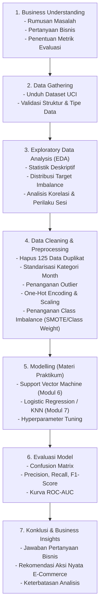

# Prediksi Niat Pembelian Pengunjung Toko Online Berdasarkan Perilaku Sesi
### Proyek Akhir Praktikum Data Science (Semester Ganjil 2026/2027)
**Program Studi Informatika — Fakultas Teknik Industri**  
**Universitas Pembangunan Nasional "Veteran" Yogyakarta**

---

[](https://www.python.org/)
[](https://jupyter.org/)
[](https://creativecommons.org/licenses/by/4.0/)
[](https://archive.ics.uci.edu/dataset/468/online+shoppers+purchasing+intention+dataset)

---

## 👥 Informasi Kelompok

- **Nomor Kelompok**: 61
- **Nama Kelompok**: Mau ARGON atau ASTRA?
- **Kelas Teori / Praktikum**: IF-H

### Anggota Kelompok & Pembagian Kontribusi

| No | NIM | Nama Mahasiswa | Kelas | Peran & Kontribusi Utama |
|:--:|:---:|:---------------|:-----:|:-------------------------|
| 1 | **123240135** | **Oktavian Prasetya Adi** | IF-H | *Project Management*, *Business Understanding*, *Data Cleaning & Preprocessing* |
| 2 | **123240019** | **Marvel Valensiano** | IF-H | *Data Gathering*, *Exploratory Data Analysis (EDA)*, & Visualisasi Data |
| 3 | **123240069** | **Adhafa Joan Putranto** | IF-H | *Feature Engineering*, *Model Development* (SVM & Klasifikasi) |
| 4 | **123240160** | **Dzaki Ghatfaan Abhipraya** | IF-H | *Model Evaluation*, Interpretasi Metrik, *Conclusion* & Dokumentasi |

---

## 📌 Ringkasan Proyek

Dalam ekosistem perdagangan elektronik (*e-commerce*), tingkat konversi dari pengunjung situs menjadi pembeli riil umumnya relatif rendah (berkisar 2%–5%). Banyak pengunjung yang menjelajahi situs web, menambahkan produk, namun mengurungkan niat transaksi (*shopping cart abandonment*). 

Proyek ini bertujuan untuk membangun model *Machine Learning* klasifikasi biner berbasis data perilaku sesi (*session behavior*) guna memprediksi apakah suatu sesi kunjungan pengguna di situs web toko *online* akan menghasilkan transaksi pembelian (`Revenue = True`) atau tidak (`Revenue = False`). Melalui identifikasi dini niat beli pengunjung secara *real-time*, pihak pengelola toko *online* dapat memberikan insentif atau intervensi dinamis (seperti pemberian kupon diskon khusus, penawaran bantuan interaktif *live-chat*, atau peringatan stok terbatas) untuk mendorong penyelesaian transaksi.

---

## 🎯 1. Business Understanding

### 1.1 Latar Belakang
Mengoptimalkan strategi retensi dan konversi pengunjung merupakan prioritas utama bisnis retail digital. Memahami pola interaksi navigasi halaman web—seperti jenis halaman yang dibuka, durasi kunjungan, nilai signifikansi halaman (*PageValues*), serta rasio keluar (*ExitRates*)—memungkinkan platform mendeteksi sinyal pembelian secara objektif tanpa harus menunggu pengguna meninggalkan situs.

### 1.2 Rumusan Masalah
Bagaimana memanfaatkan metrik perilaku sesi navigasi web dan variabel temporal guna memprediksi secara akurat apakah pengunjung toko *online* memiliki niat melakukan transaksi pembelian pada sesi tersebut?

### 1.3 Pertanyaan Bisnis (Business Questions)
1. Fitur aktivitas navigasi apa (misalnya `PageValues`, durasi pada halaman produk `ProductRelated_Duration`, `BounceRates`, dan `ExitRates`) yang memiliki pengaruh paling signifikan terhadap kecenderungan pengguna untuk bertransaksi?
2. Bagaimana pengaruh faktor temporal (bulan kunjungan, hari libur akhir pekan, dan kedekatan sesi dengan hari raya / *Special Day*) terhadap rasio konversi pembelian?
3. Model klasifikasi berbasis materi praktikum (*Support Vector Machine* / SVM dan model pembanding klasifikasi seperti *Logistic Regression* atau *KNN*) manakah yang memberikan performa terbaik dalam mendeteksi kelas minoritas pembeli (*imbalanced class*)?

### 1.4 Tujuan Proyek
- Mengeksplorasi dan menganalisis korelasi perilaku sesi penjelajahan web dengan keputusan transaksi.
- Melakukan pembersihan data (*data cleaning*) dan pra-pemrosesan (*preprocessing*) terhadap pencilan (*outlier*), duplikasi data, dan ketimpangan distribusi kelas.
- Mengembangkan model klasifikasi *Supervised Learning* sesuai kurikulum materi praktikum Data Science.
- Memberikan wawasan analitis serta rekomendasi bisnis operasional yang dapat diimplementasikan untuk meningkatkan rasio konversi.

### 1.5 Pendekatan & Metrik Evaluasi
- **Metode**: *Supervised Learning — Binary Classification* (`Revenue`: `True` vs `False`).
- **Tantangan Data**: Terdapat *Class Imbalance* yang signifikan (~84,5% pengunjung tidak membeli dan ~15,5% berujung transaksi).
- **Metrik Evaluasi**: Mengingat akurasi (*Accuracy*) dapat memberikan ilusi performa yang menyesatkan pada data tidak seimbang, evaluasi difokuskan pada:
  - **F1-Score (Macro & Positive Class)**: Keseimbangan harmonis antara *Precision* dan *Recall*.
  - **Recall (Sensitivity)**: Mengukur seberapa banyak calon pembeli aktual yang berhasil dideteksi oleh sistem.
  - **Precision**: Memastikan intervensi pemasaran tidak salah sasaran ke pengunjung yang memang tidak berniat membeli.
  - **Area Under the ROC Curve (ROC-AUC)** & **Confusion Matrix**: Menilai kemampuan pemisahan kelas oleh model pada berbagai variasi ambang batas (*threshold*).

---

## 📊 2. Data Gathering & Pemahaman Dataset

Dataset yang digunakan bersumber dari repositori publik kredibel:
- **Nama Dataset**: *Online Shoppers Purchasing Intention Dataset*
- **Sumber**: [UCI Machine Learning Repository](https://archive.ics.uci.edu/dataset/468/online+shoppers+purchasing+intention+dataset)
- **DOI / Sitasi**: C. Sakar & S. Polat (2019), *Online Shoppers Purchasing Intention Dataset*, UCI Machine Learning Repository.
- **Lisensi**: Creative Commons Attribution 4.0 International (CC BY 4.0).
- **Dimensi Dataset**: 12.330 baris (sesi) dan 18 kolom fitur.
- **Kondisi Awal Data**: Memenuhi kriteria dataset panduan praktikum (terdapat 125 baris duplikat, adanya variasi pencilan durasi sesi, serta ketimpangan kelas target).

### Kamus Data (Data Dictionary)

| No | Nama Kolom | Tipe Data | Kategori | Deskripsi |
|:--:|:-----------|:---------:|:--------:|:----------|
| 1 | `Administrative` | Integer | Fitur Numerik | Jumlah kunjungan ke halaman administratif akun/profil dalam sesi |
| 2 | `Administrative_Duration` | Float | Fitur Numerik | Total waktu (detik) yang dihabiskan pada halaman administratif |
| 3 | `Informational` | Integer | Fitur Numerik | Jumlah kunjungan ke halaman informasi/kebijakan toko dalam sesi |
| 4 | `Informational_Duration` | Float | Fitur Numerik | Total waktu (detik) yang dihabiskan pada halaman informasi |
| 5 | `ProductRelated` | Integer | Fitur Numerik | Jumlah kunjungan ke halaman katalog produk dalam sesi |
| 6 | `ProductRelated_Duration` | Float | Fitur Numerik | Total durasi (detik) melihat katalog produk |
| 7 | `BounceRates` | Float | Fitur Numerik | Persentase pengunjung yang masuk dan langsung keluar tanpa melihat halaman lain |
| 8 | `ExitRates` | Float | Fitur Numerik | Persentase tampilan halaman yang menjadi halaman terakhir dalam sesi |
| 9 | `PageValues` | Float | Fitur Numerik | Rata-rata nilai halaman sebelum pengguna menyelesaikan transaksi *e-commerce* |
| 10 | `SpecialDay` | Float | Fitur Numerik | Kedekatan tanggal kunjungan dengan hari perayaan tertentu (rentang 0.0 - 1.0) |
| 11 | `Month` | Object | Fitur Kategorikal | Bulan sesi kunjungan dilakukan (Feb, Mar, May, June, Jul, Aug, Sep, Oct, Nov, Dec) |
| 12 | `OperatingSystems` | Integer | Fitur Kategorikal | Kode identifikasi sistem operasi perangkat pengguna (1 s.d. 8) |
| 13 | `Browser` | Integer | Fitur Kategorikal | Kode identifikasi peramban/browser web yang digunakan (1 s.d. 13) |
| 14 | `Region` | Integer | Fitur Kategorikal | Kode wilayah geografis lokasi pengguna (1 s.d. 9) |
| 15 | `TrafficType` | Integer | Fitur Kategorikal | Kode sumber lalu lintas/saluran rujukan (1 s.d. 20) |
| 16 | `VisitorType` | Object | Fitur Kategorikal | Tipe pengunjung: `Returning_Visitor`, `New_Visitor`, atau `Other` |
| 17 | `Weekend` | Boolean | Fitur Temporal | Indikator apakah sesi terjadi pada akhir pekan (`True`/`False`) |
| 18 | `Revenue` | Boolean | **Target Label** | Indikator apakah sesi menghasilkan transaksi pembelian (`True`/`False`) |

---

## 🔄 3. Alur Kerja Proyek (Project Workflow)

Proyek ini dilaksanakan mengikuti siklus metodologi *Data Science* terstruktur sesuai panduan:



---

## 📁 4. Struktur Repository

```text
MauArgonAtauAstra/
│
├── data/                                         <- Direktori dataset proyek
│   ├── online_shoppers_intention.csv             <- Dataset mentah dari UCI Repository
│   └── (processed data jika disimpan)
│
├── notebooks/                                    <- Jupyter Notebook pengerjaan proyek
│   └── Proyek_Akhir_Data_Science_Kelompok61.ipynb <- Notebook alur lengkap (Tahap 1 s.d. 7)
│
├── reports/                                      <- Visualisasi & dokumentasi pendukung
│   └── figures/
│
├── .gitignore                                    <- Mengabaikan venv, cache, dan checkpoint
├── requirements.txt                              <- Daftar pustaka/dependensi Python
└── README.md                                     <- Dokumentasi utama proyek
```

---

## ⚙️ 5. Panduan Instalasi & Penggunaan (How to Run)

Ikuti langkah-langkah berikut untuk mereplikasi dan menjalankan proyek ini di lingkungan lokal Anda:

### 1. Kloning Repository
Buka terminal / command prompt dan jalankan perintah:
```bash
git clone https://github.com/oktavianprstyd/MauArgonAtauAstra.git
cd MauArgonAtauAstra
```

### 2. Membuat dan Mengaktifkan Virtual Environment (Direkomendasikan)
- **Windows (PowerShell)**:
  ```powershell
  python -m venv venv
  .\venv\Scripts\Activate.ps1
  ```
- **macOS / Linux**:
  ```bash
  python3 -m venv venv
  source venv/bin/activate
  ```

### 3. Memasang Dependensi Pustaka
Pasang semua paket yang diperlukan melalui `requirements.txt`:
```bash
pip install --upgrade pip
pip install -r requirements.txt
```

### 4. Menjalankan Jupyter Notebook
Buka Jupyter Notebook atau VS Code:
```bash
jupyter notebook notebooks/Proyek_Akhir_Data_Science_Kelompok61.ipynb
```
Jalankan sel-sel kode secara berurutan mulai dari bagian **Data Gathering** hingga **Konklusi**.

---

## 📦 6. Dependensi Pustaka (Dependencies)

Proyek ini dibangun menggunakan Python 3.10+ dengan pustaka-pustaka standar *Data Science*:
- `pandas` — Manipulasi dan analisis data tabular.
- `numpy` — Operasi komputasi numerik dan matriks.
- `matplotlib` & `seaborn` — Visualisasi data dan grafik korelasi.
- `scikit-learn` — Algoritma machine learning, pra-pemrosesan, dan metrik evaluasi.
- `imbalanced-learn` — Penanganan ketidakseimbangan kelas target (*oversampling / SMOTE*).
- `jupyter` / `notebook` — Lingkungan interaktif eksekusi kode eksperimen.

---

## 🗓️ 7. Jadwal Milestone Pengumpulan

Berdasarkan Panduan Proyek Akhir Praktikum Data Science 2026/2027:
1. **18 Oktober 2026**: Pencatatan Kelompok & Dataset (Tercatat: Kelompok 61).
2. **30 Oktober 2026**: Pengumpulan Tahap 1 (Tautan Repository berisikan *Business Understanding, Data Gathering, EDA, Cleaning & Preprocessing*).
3. **22 November 2026**: Pengumpulan Final Repository lengkap beserta *Modelling, Evaluasi, dan Konklusi*.
4. **23 November – 4 Desember 2026**: Sesi Presentasi dan Tanya Jawab di Laboratorium Informatika.

---

## 📝 8. Lisensi & Hak Cipta

Proyek ini disusun untuk pemenuhan tugas akademik Proyek Akhir Praktikum Data Science 2026/2027 pada Program Studi Informatika, UPN "Veteran" Yogyakarta. Dataset dilisensikan di bawah [Creative Commons Attribution 4.0 International (CC BY 4.0)](https://creativecommons.org/licenses/by/4.0/).
